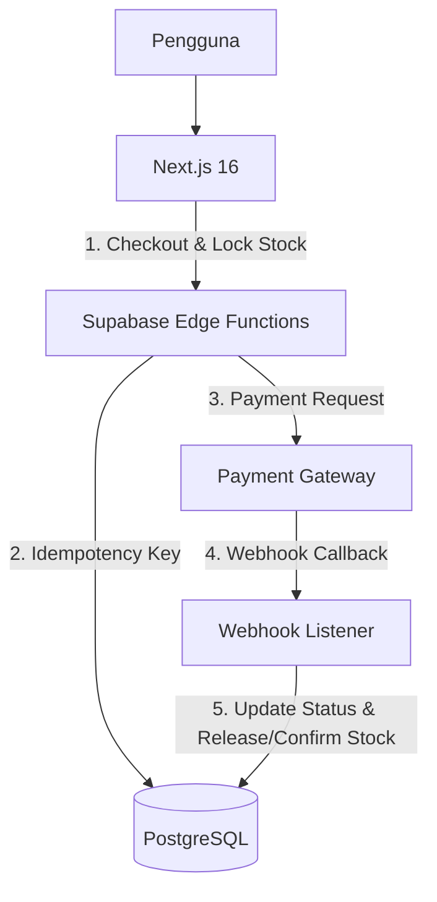
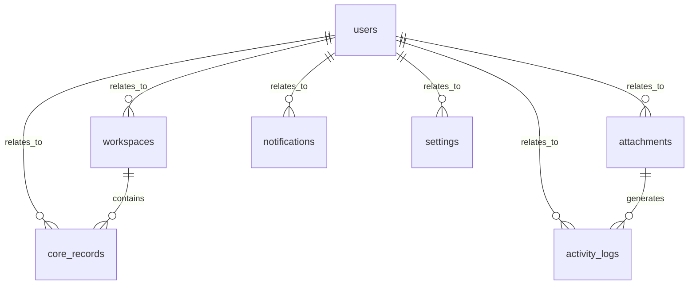

# PRD — Uniqlo-Style E-commerce Platform

## 1. Overview

### 1.1 Problem Statement & Konteks Lapangan
Lack of a high-performance, scalable e-commerce platform with complex inventory management and seamless user experience.

### 1.2 Hipotesis Solusi & Alur Kunci
By implementing a robust Supabase-backed PostgreSQL architecture, we can leverage built-in Auth, Realtime, and RLS for rapid development and high data integrity.

### 1.3 Keunggulan Strategis & Keselarasan Solusi
Aligns with modern cloud-native standards for e-commerce scalability using Supabase ecosystem.

### 1.4 Target Persona & Pengguna Sistem
Pengembang & Pengguna Akhir

### 1.5 Target Metrik & KPI Produksi
- **Metrik Operasional / Online**: Tingkat keberhasilan tugas pengguna > 90%, latensi < 1 detik, dan zero double-charge rate.
- **Validasi Fungsional / Golden Set**: Evaluasi fungsional dan pengujian integrasi lulus 100%.

## 2. Requirements

### Persyaratan Fungsional

- Pengguna dapat mengelola supabase PostgreSQL database implementation.
- Pengguna dapat mengelola supabase Auth integration.
- Pengguna dapat mengelola supabase Realtime for inventory updates.
- Pengguna dapat mengelola user authentication and product catalog management.
- Pengguna dapat mengelola inventory tracking with time-bound locking.
- Pengguna dapat mengelola e-commerce product display optimization.
- Pengguna dapat mengelola responsive mobile-first layout refinement.
- Pengguna dapat mengelola payment gateway integration with idempotency management.
- Pengguna dapat mengelola webhook-based transaction reconciliation.

### Persyaratan Non-Fungsional

- Antarmuka sederhana dan ramah untuk Pengembang & Pengguna Akhir (navigasi intuitif, alur ringkas, istilah mudah dipahami).
- Responsif: nyaman dan optimal dipakai di perangkat mobile/HP, tablet, maupun laptop/desktop untuk menunjang fleksibilitas Pengembang & Pengguna Akhir.
- Keamanan Data: data uniqlo-style e-commerce platform terisolasi dan hanya bisa diakses oleh akun terautentikasi sesuai hak akses (terproteksi sesi login aman).
- Penyimpanan Aman: berkas dokumen, lampiran, dan data operasional tersimpan aman secara persisten serta dapat diakses kembali.
- Integritas Riwayat: riwayat pencatatan dan aktivitas tidak hilang (didukung mekanisme soft-delete dan jejak audit) untuk akuntabilitas data.
- Proses simpan dan pemuatan data terasa cepat (< 2 detik) agar tidak mengganggu aktivitas harian pengguna.
- Mitigasi operasional: Fitur flag untuk mematikan modul bermasalah secara instan.

### Asumsi & Batasan

- Skala pengguna: dirancang untuk Pengembang & Pengguna Akhir dengan kapasitas dan struktur data terkelola.
- Satu akun pengguna terhubung ke profil/ruang kerja utama pada versi rilis awal Uniqlo-Style E-commerce Platform.
- Legacy database migration.
- Bahasa antarmuka Indonesia.

## 3. Core Features

Fitur di bawah ini disusun mengikuti urutan fase pada kerangka fitur yang sudah disetujui.

## 4. User Flow

Alur utama yang akan dilalui pengguna, disusun mengikuti urutan fase:

1. **Daftar & Masuk (Fase 1 – pondasi akses)**: Pengguna membuat akun baru dan melakukan autentikasi login. Setelah masuk, pengguna melengkapi konfigurasi profil pengguna pada Uniqlo-Style E-commerce Platform.

2. **Kelola Data Master & Preferensi (Fase 2)**: Pengguna menginput data referensi awal, parameter pengaturan, dan konfigurasi operasional.

3. **Pencatatan Operasional Harian (Fase 2 – first win)**: Pengguna mencatat transaksi atau entri data aktif harian. Sistem langsung memvalidasi input dan memperbarui status secara instan.

4. **Pantau Dashboard & Laporan (Fase 3)**: Pengguna membuka dashboard untuk melihat analitik pergerakan data, memeriksa notifikasi peringatan, dan mengunduh berkas laporan rekapitulasi.

## 5. Architecture

Arsitektur sistem dirancang dengan prinsip pemisahan tanggung jawab (separation of concerns), keamanan tingkat produksi, dan pemetaan alur transaksi inti (critical path) yang jelas. Komponen di bawah memetakan bagaimana antarmuka pengguna, logika server, basis data, dan integrasi eksternal berinteraksi secara efisien.

### Gambaran sistem:

- **Antarmuka pengguna**: Halaman web responsif yang menampilkan dashboard, katalog data, formulir pencatatan, dan laporan.
- **Logika server**: Menangani aturan bisnis — alur dashboard, katalog data, formulir pencatatan, dan laporan, validasi skema data Zod, otorisasi sesi, dan integritas data.
- **Basis data**: Menyimpan data akun pengguna, profil organisasi, entitas katalog, pergerakan data, dan riwayat audit menggunakan Supabase.
- **Layanan autentikasi**: Mengatur pendaftaran akun pengguna, login/logout sesi aman (session cookies/JWT), dan pembatasan hak akses peran.

### Diagram alur sistem:

## 6. Database Schema

Berikut tabel-tabel utama yang dibutuhkan. Nama kolom memakai huruf kecil dengan garis bawah.

### 1. users — data akun pengguna (dikelola sistem autentikasi / Supabase Auth)

| Kolom | Tipe | Kegunaan |
| :--- | :--- | :--- |
| `id` | `text` | ID unik akun |
| `email` | `text` | Email untuk login (unik) |
| `full_name` | `text` | Data full name |
| `role` | `text` | Peran: admin (pemilik) atau staff |
| `avatar_url` | `text` | Foto profil (opsional) |
| `status` | `text` | Status operasional (draft / selesai) |
| `created_at` | `timestamp` | Waktu dibuat |
| `updated_at` | `timestamp` | Waktu terakhir diperbarui |

### 2. notifications — log notifikasi peringatan & pesan sistem

| Kolom | Tipe | Kegunaan |
| :--- | :--- | :--- |
| `id` | `text` | ID unik notifications |
| `user_id` | `text` | Relasi ke users (pemilik/pengguna) |
| `title` | `text` | Data title |
| `content` | `text` | Isi teks pesan broadcast |
| `channel` | `text` | Data channel |
| `is_read` | `boolean` | Status apakah notifikasi sudah dibaca |
| `created_at` | `timestamp` | Waktu dibuat |
| `updated_at` | `timestamp` | Waktu terakhir diperbarui |

### 3. activity_logs — data activity logs

| Kolom | Tipe | Kegunaan |
| :--- | :--- | :--- |
| `id` | `text` | ID unik activity logs |
| `user_id` | `text` | Relasi ke users (pemilik/pengguna) |
| `name` | `text` | Nama activity logs |
| `status` | `text` | Status operasional (draft / selesai) |
| `metadata` | `json` | Data metadata |
| `created_at` | `timestamp` | Waktu dibuat |
| `updated_at` | `timestamp` | Waktu terakhir diperbarui |

### 4. attachments — data attachments

| Kolom | Tipe | Kegunaan |
| :--- | :--- | :--- |
| `id` | `text` | ID unik attachments |
| `user_id` | `text` | Relasi ke users (pemilik/pengguna) |
| `name` | `text` | Nama attachments |
| `status` | `text` | Status operasional (draft / selesai) |
| `metadata` | `json` | Data metadata |
| `created_at` | `timestamp` | Waktu dibuat |
| `updated_at` | `timestamp` | Waktu terakhir diperbarui |

### 5. core_records — data core records

| Kolom | Tipe | Kegunaan |
| :--- | :--- | :--- |
| `id` | `text` | ID unik core records |
| `user_id` | `text` | Relasi ke users (pemilik/pengguna) |
| `name` | `text` | Nama core records |
| `status` | `text` | Status operasional (draft / selesai) |
| `metadata` | `json` | Data metadata |
| `created_at` | `timestamp` | Waktu dibuat |
| `updated_at` | `timestamp` | Waktu terakhir diperbarui |

### 6. settings — data settings

| Kolom | Tipe | Kegunaan |
| :--- | :--- | :--- |
| `id` | `text` | ID unik settings |
| `user_id` | `text` | Relasi ke users (pemilik/pengguna) |
| `name` | `text` | Nama settings |
| `status` | `text` | Status operasional (draft / selesai) |
| `metadata` | `json` | Data metadata |
| `created_at` | `timestamp` | Waktu dibuat |
| `updated_at` | `timestamp` | Waktu terakhir diperbarui |

### 7. workspaces — ruang kerja atau grup profil pengguna

| Kolom | Tipe | Kegunaan |
| :--- | :--- | :--- |
| `id` | `text` | ID unik workspaces |
| `user_id` | `text` | Relasi ke users (pemilik/pengguna) |
| `name` | `text` | Nama workspaces |
| `status` | `text` | Status operasional (draft / selesai) |
| `metadata` | `json` | Data metadata |
| `created_at` | `timestamp` | Waktu dibuat |
| `updated_at` | `timestamp` | Waktu terakhir diperbarui |

### Diagram hubungan antar tabel (ER):

## 7. Tech Stack

Karena pilihan teknologi diserahkan ke AI, berikut rekomendasi yang paling cocok untuk aplikasi uniqlostyle ecommerce platform skala kecil — sederhana, cepat dibangun, dan mudah dirawat.

- **Framework (Frontend + Backend):** Next.js (App Router) — menangani antarmuka sekaligus logika server dalam satu proyek.
- **UI & Styling:** Tailwind CSS + shadcn/ui — komponen siap pakai yang rapi, cepat, dan konsisten; cocok untuk tampilan dashboard dan tabel yang perlu enak dibaca.
- **ORM:** Drizzle ORM — ringan dan jelas, memudahkan pengelolaan skema serta query ke basis data.
- **Basis Data:** Supabase (PostgreSQL) — basis data relasional terkelola dengan Row Level Security (RLS) bawaan, integritas relasi foreign key, dan performa tinggi.
- **Autentikasi:** Better Auth — menangani daftar akun, login/logout, sesi, dan ganti kata sandi.
- **Deployment:** Vercel — cocok dengan Next.js, mudah di-deploy, dan hemat biaya. Alternatif: VPS kecil bila ingin basis data & file tersimpan lokal.
- **Validasi Form:** Zod — memastikan data yang diisi pengguna valid sebelum disimpan.

Catatan: Aplikasi ini tidak memerlukan fitur AI, sehingga layanan AI/gateway tidak disertakan dalam stack.

